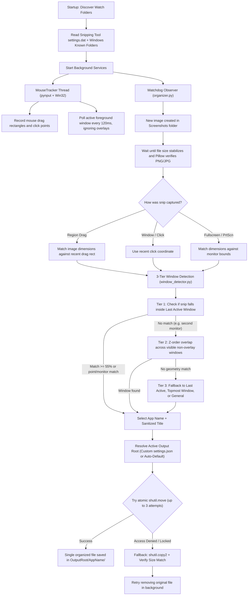

# Context-Aware Screenshots


[](LICENSE)


A lightweight, **100% offline** Windows background utility that automatically organizes your screenshots (Snipping Tool `Win + Shift + S` and `PrtScn` / `Win + PrtScn`) into clean, application-specific subfolders with window-title filenames.

* **100% Offline:** Zero network calls, zero telemetry, and zero cloud uploads.
* **No AI / No OCR:** Uses native Windows Win32, DWM, and Shell APIs—no LLMs, computer vision models, or image scanning.
* **No Screenshot Data Stored:** Never stores or indexes image contents in any database. Only optional user folder preference (`%APPDATA%\ContextScreenshots\settings.json`) and an ordinary local text log (`context_screenshots.log`) are saved on disk.

---

## Features

* **Automatic App & Window Detection:** Places screenshots into `<SaveRoot>\<AppName>\<OriginalName> - <CleanWindowTitle>.png`.
* **Multi-Monitor, Active-Window & Overlay Aware:** Tracks recent mouse drags, clicks, and your active foreground window while ignoring transparent overlays (Discord Overlay, Steam Overlay, GeForce Overlay, Xbox Game Bar, RTSS) and background games when snipping another window.
* **Dynamic Snipping Tool Folder Detection:** Automatically detects where Windows saves screenshots from Snipping Tool's own UWP settings (`settings.dat`), Windows Known Folders (`FOLDERID_Screenshots`), and Explorer Shell Folders—no hardcoded paths or usernames.
* **Customizable Save Root:** Choose any destination folder directly from the System Tray (**Change Save Folder...**) or CLI (`--set-output`), taking effect immediately without restarting.
* **Portable Standalone EXE:** Built as a single-file Windows executable (`dist\ContextScreenshots.exe`) with no Python installation required.

---

## Quick Start & Usage

### Option 1: Standalone Desktop App (Recommended)

1. Run **`dist\ContextScreenshots.exe`** (or download/share it with anyone—everything needed is bundled inside).
2. A camera icon appears in your **Windows System Tray** (bottom-right notification area next to the clock).
3. Take any screenshot with **`Win + Shift + S`** or **`PrtScn`**—it is automatically moved and renamed into `<SaveRoot>\<AppName>\`.

**System Tray Menu (Right-Click Icon):**

| Menu Item | Action |
| :--- | :--- |
| **Open Screenshots Folder** *(Double-Click)* | Opens your active organized screenshots root folder |
| **Change Save Folder...** | Opens a Windows folder picker to choose a custom destination root (applies live) |
| **Reset Save Folder to Default** | Reverts back to the auto-detected writable default save folder |
| **Run on Windows Startup** | Toggles auto-launch at Windows login via a silent `.vbs` launcher in your Startup folder |
| **View Logs** | Opens `context_screenshots.log` next to the executable |
| **Exit** | Stops mouse tracking and file watching cleanly |

---

### Option 2: Running from Python CLI

Install dependencies:

```bash
pip install -r requirements.txt
```

Run via **`context_screenshots.py`**:

```bash
# Run in foreground with live console logs
python context_screenshots.py

# Background service controls
python context_screenshots.py --start
python context_screenshots.py --status
python context_screenshots.py --stop

# Configuration & output root controls
python context_screenshots.py --show-config
python context_screenshots.py --set-output "D:\MyScreenshots"
python context_screenshots.py --reset-output

# Windows Startup management
python context_screenshots.py --install-startup
python context_screenshots.py --uninstall-startup
```

> To launch the System Tray GUI directly from Python source: `python app.py`

---

## Folder & Naming Structure

Screenshots are organized inside your active destination root (your custom save folder, or the auto-detected writable screenshots folder):

```text
<OutputRoot>/
├── Brave/
│   └── Screenshot 2026-11-04 181732 - Video Title.png
├── Chrome/
│   └── Screenshot 2026-11-04 191024 - Pull Request 42.png
├── Discord/
│   └── Screenshot 2026-11-04 194312 - game-chat.png
├── Genshin Impact/
│   └── Screenshot 2026-11-11 021832 - Genshin Impact.png
├── VS Code/
│   └── Screenshot 2026-11-04 192501 - main.py.png
└── General/
    └── Screenshot 2026-11-04 200105.png
```

---

## Core Workflow (Mermaid Diagram)



---

## Core Architecture & Modules

| Module / File | Purpose & Key Libraries |
| :--- | :--- |
| **`app.py`** | System Tray GUI entrypoint built with `pystray` and `Pillow`. Enforces single-instance execution via a Win32 named mutex (`CreateMutexW`), launches a dedicated single-thread `tkinter` folder picker (`SHBrowseForFolder` fallback), manages Windows Startup `.vbs` creation, and coordinates live destination reloads. |
| **`context_screenshots.py`** | CLI service controller. Uses `argparse`, `subprocess`, and `psutil` to run in foreground or detached silent background mode (`pythonw.exe` + PID file `.context_screenshots.pid`), inspect detected config (`--show-config`), and update the persistent save root. |
| **`snipping_settings.py`** | Reads and stores user preferences in `%APPDATA%\ContextScreenshots\settings.json`. Dynamically discovers Windows screenshot save folders via `advapi32.RegLoadAppKeyW` (parsing Snipping Tool's UWP `settings.dat`), `winreg` (`PersistedStorageItemTable`, `User Shell Folders`), `shell32.SHGetKnownFolderPath`, and `kernel32.GetVolumePathNamesForVolumeNameW`. |
| **`config.py`** | Central configuration mapping executable names (`chrome.exe`, `code.exe`, `yuanshen.exe`, etc.) to friendly folder names (`FRIENDLY_APP_NAMES`), listing host/overlay processes and titles to ignore (`SNIP_HOST_PROCESSES`, `OVERLAY_PROCESSES`, `KNOWN_OVERLAY_TITLES`), and defining timing/pixel tolerances. |
| **`mouse_tracker.py`** | DPI-aware background input and window tracker (`pynput.mouse`, `psutil`, `ctypes` Win32/DWM). Keeps a bounded rolling in-memory history (`maxlen=30`) of drag rectangles and clicks, plus a `0.12s` poller recording the user's active window while ignoring Snipping Tool hosts and Discord overlays. |
| **`window_detector.py`** | Identifies the target app and window title cleanly using Win32 Desktop enumeration (`EnumDesktopWindows`), `DwmGetWindowAttribute` (`DWMWA_EXTENDED_FRAME_BOUNDS` and `DWMWA_CLOAKED`), `EnumDisplayMonitors`, overlay style checks (`WS_EX_TRANSPARENT`, `WS_EX_TOOLWINDOW`), and filename sanitization. |
| **`organizer.py`** | Filesystem event processor built on `watchdog`. Waits for complete image writes (`PIL.Image.verify`), coordinates `MouseTracker` + `window_detector`, handles destination routing and collision-safe naming (`name (1).png`), retries brief file locks on move/copy, and verifies destination integrity before cleaning up originals. |
| **`build_exe.bat` / `ContextScreenshots.spec`** | Reproducible PyInstaller `--onefile --noconsole` build configuration bundling all modules, `icon.ico`, `pynput` Win32 hooks, and `tkinter`. |

---

## Rebuilding the Standalone EXE

Whenever you modify any Python source file, double-click **`build_exe.bat`** or run:

```bash
python -m PyInstaller --noconfirm --noconsole --onefile --icon=icon.ico --add-data "icon.ico;." --hidden-import=pynput.keyboard._win32 --hidden-import=pynput.mouse._win32 --hidden-import=tkinter --hidden-import=tkinter.filedialog --name "ContextScreenshots" app.py
```

The compiled executable is generated at **`dist\ContextScreenshots.exe`**.

---

## Detailed Documentation

For deep technical documentation explaining the internal mechanics of every file in the codebase, see the [`docs/`](docs/architecture.md) folder:

* [`docs/architecture.md`](docs/architecture.md) — System architecture, threading model, and data flow
* [`docs/app.md`](docs/app.md) — Tray GUI, single-instance mutex, and folder-picker worker (`app.py`)
* [`docs/context_screenshots.md`](docs/context_screenshots.md) — CLI runner, detached daemon, and startup management (`context_screenshots.py`)
* [`docs/snipping_settings.md`](docs/snipping_settings.md) — Dynamic Snipping Tool UWP settings & `settings.json` persistence (`snipping_settings.py`)
* [`docs/config.md`](docs/config.md) — App name mappings, overlay exclusions, and tolerances (`config.py`)
* [`docs/mouse_tracker.md`](docs/mouse_tracker.md) — Drag/click capture and active-window tracking (`mouse_tracker.py`)
* [`docs/window_detector.md`](docs/window_detector.md) — 3-tier Win32/DWM window identification and title sanitization (`window_detector.py`)
* [`docs/organizer.md`](docs/organizer.md) — Watchdog handling, writability fallbacks, and move/cleanup lifecycle (`organizer.py`)

---

## License

Released under the [MIT License](LICENSE).
