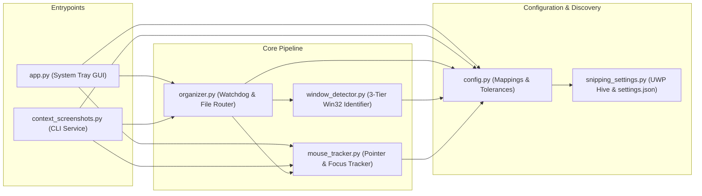

# High-Level System Architecture

Context-Aware Screenshots is a pure local Windows automation pipeline built on Win32/DWM APIs, filesystem event hooks, and lightweight input tracking. It performs all detection strictly from OS window metadata and recent pointer geometry—no AI models, OCR, network connections, or image databases are used.

---

## Component Dependency Map

---

## Runtime Threading & Concurrency Model

When running (`app.py` or `context_screenshots.py`), four lightweight daemon/worker execution contexts cooperate in memory:

1. **Main Thread:**
   * In `app.py`: Pumps Windows system tray messages via `pystray.Icon.run()`.
   * In `context_screenshots.py`: Sleeps in a 1-second loop until `KeyboardInterrupt` or process termination.
2. **Mouse Listener Thread (`pynput.mouse.Listener`):**
   * Listens passively to global left mouse button press/release coordinates (`x, y`).
   * Distinguishes drags (`w > 10 and h > 10` pixels) from single clicks and stores them in bounded deques (`maxlen=30`) guarded by `threading.Lock`.
3. **Active Foreground Window Poller (`MouseTracker._track_foreground_loop`):**
   * Samples `GetForegroundWindow()` every `0.12` seconds.
   * Deliberately ignores Snipping Tool / Windows Shell flyout processes (`SNIP_HOST_PROCESSES`) and Discord overlays so the window the user had open *before* triggering `Win + Shift + S` stays preserved as `last_active_window`.
4. **Watchdog Filesystem Observer (`watchdog.observers.Observer`):**
   * Watches each discovered Screenshots root folder non-recursively (`recursive=False`).
   * On new `.png` / `.jpg` / `.jpeg` creation or move events inside the watched root, waits until the image is fully flushed (`PIL.Image.verify()`), runs 3-tier window identification, and moves/organizes the file into `<OutputRoot>/<AppName>/`.
5. **On-Demand Helper Threads:**
   * `FolderPickerThread` (`app.py`): Created lazily on the first tray **Change Save Folder...** click and kept alive as a single persistent Tcl/Tk apartment thread to safely display native Explorer folder dialogs repeatedly.
   * Cleanup retry threads (`organizer.py`): Spawned only when `shutil.move` falls back to `shutil.copy2` and immediate `unlink()` fails due to a transient handle lock.

---

## Privacy & Offline Guarantees

| Aspect | Behavior |
| :--- | :--- |
| **Network Activity** | Zero sockets, zero HTTP calls, zero external APIs or telemetry. |
| **Screenshot Pixel Inspection** | Only opens image headers briefly via `PIL.Image` to verify the file finished writing and read `(width, height)` pixel dimensions. Pixel contents are never analyzed or stored. |
| **Persistent State** | Only stores your custom output folder path (if configured) in `%APPDATA%\ContextScreenshots\settings.json`, plus runtime diagnostics in `context_screenshots.log` next to the script/executable. |

